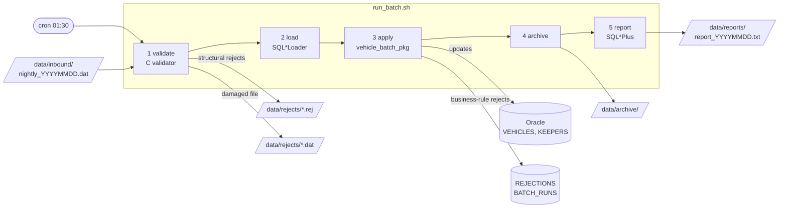

# Vehicle Records Batch Processor

A small, working replica of a legacy government overnight batch system, in
the style of a national vehicle register.

Every night a fixed-width file of vehicle-record changes arrives: new
keepers, colour changes and scrapped vehicles. A cron-scheduled shell script
runs it through a C pre-validator and an Oracle PL/SQL package that applies
the business rules. Valid changes update the database. Invalid ones are
rejected with a reason, and a summary report is written for the morning team.

Built as a portfolio piece for a Legacy Software Engineer role. The aim is
realism and readability rather than features: clear error handling, logging
and documentation, and a [runbook](RUNBOOK.md) of real incidents.

## How it works



| Stage | What it does | On failure |
|---|---|---|
| **validate** | `build/validator` checks the header, the trailer's record count, and each record's structure: length, characters, registration format, change type, real date, required values. | Bad records go to a rejects file. A truncated or damaged file is rejected whole (exit 4) and quarantined. |
| **load** | SQL*Loader loads the clean and rejects files into staging tables (`BATCH_INPUT`, `BATCH_INPUT_REJECTS`). | Exit 5. |
| **apply** | `vehicle_batch_pkg.process_file` applies each record in file order. Checks: does the vehicle exist, is it already scrapped, is the postcode valid, is the keeper date after the current keeper's. Each record is atomic (savepoint); the file commits once. | A failed run applies nothing, so it is safe to rerun (exit 6). Refuses a file already processed, or a run while another is `RUNNING`. |
| **archive** | Moves the file to `data/archive/`. | Exit 7: changes applied, move the file by hand. |
| **report** | SQL*Plus report: totals, rejections by stage and reason with subtotals, rejection detail, recent runs. | Exit 8: changes applied, rebuild the report. Every failed night also gets a `_FAILED_` report. |

Every stage logs timestamped (UTC) lines to `data/logs/`. Each exit code
means one thing, so monitoring can tell what broke without reading the log.
See the table in [RUNBOOK.md](RUNBOOK.md#1-read-the-exit-code-and-the-report).

## Data

- **Vehicles:** DVSA anonymised MOT test results (2024), comma-delimited
  CSV, published under the Open Government Licence. A 50,000-row sample
  seeds about 26,000 vehicles (make, model, colour, fuel type, first-use
  date, mileage). Each vehicle takes its values from its latest test.
- **Registrations:** generated in PL/SQL in the current UK format
  (`AB12 CDE`), with the age identifier taken from the first-use date.
- **Keepers:** entirely synthetic (Python `Faker`, `en_GB` locale), with
  1–3 keeper periods per vehicle. **No real personal data is stored
  anywhere in this project.**
- **Nightly files:** generated by `scripts/generate_nightly.py` from the
  current vehicles, with about 1.5% deliberately bad records. Each file
  comes with a `.expected` list of the planted faults, so the batch's
  rejections can be checked exactly.

The nightly file format, rejection reason codes and validator outputs are
specified in [docs/file-format.md](docs/file-format.md).

## Set up from scratch

**Prerequisites:** Docker Desktop, a C compiler and `make` (Xcode Command
Line Tools on macOS), Python 3.10 or newer, and the DVSA 2024 MOT CSV files
(about 7 GB) in `data/MOT testing data results (2024)/`.

### 1. Start Oracle Database Free

```bash
export ORACLE_PWD='choose-a-password'   # SYS/SYSTEM password, fixed at first start
docker/oracle.sh start                  # first start pulls ~10 GB and takes several minutes
```

The image is public, so there is no `docker login`. `ORACLE_PWD` only
counts the first time the container is created. The database's own files
live in a Docker volume, `vrbp-oradata`.

### 2. Create the schema and seed the data

```bash
# Seed sample: header + 50,000 rows. The sed converts DVSA's \" escapes
# to standard CSV "" (see RUNBOOK INC-12).
head -n 50001 "data/MOT testing data results (2024)/test_result_202401.csv" \
    | sed 's/\\"/""/g' > data/seed/mot_sample.csv

docker/oracle.sh sqlplus system@FREEPDB1 @/sql/01_create_user.sql   # asks for SYSTEM, then sets VSS's password
docker/oracle.sh sqlplus vss@FREEPDB1 @/sql/02_tables.sql
docker/oracle.sh sqlplus vss@FREEPDB1 @/sql/03_staging.sql
docker/oracle.sh sqlldr  vss@FREEPDB1 control=/sql/loader/mot.ctl log=/data/logs/mot_load.log
docker/oracle.sh sqlplus vss@FREEPDB1 @/sql/04_seed_vehicles.sql

python3 -m venv .venv && .venv/bin/pip install -r requirements.txt
.venv/bin/python scripts/generate_keepers.py data/seed/mot_sample.csv data/seed/keepers.csv
docker/oracle.sh sqlldr  vss@FREEPDB1 control=/sql/loader/keepers.ctl log=/data/logs/keepers_load.log

docker/oracle.sh sqlplus vss@FREEPDB1 @/sql/05_batch_input.sql
docker/oracle.sh sqlplus vss@FREEPDB1 @/sql/06_install_pkg.sql      # ends: Package VEHICLE_BATCH_PKG installed and valid.
```

Expected: 50,000 staging rows, 25,957 vehicles and 46,782 keeper rows.
Always check the SQL*Loader log's totals, not just its exit code.

### 3. Build and test the validator

```bash
make && make test      # -> record tests passed
```

### 4. Credentials for the batch

`run_batch.sh` reads the VSS password from a file that only you can read,
and passes it to SQL*Plus and SQL*Loader on stdin, never on the command line:

```bash
mkdir -p ~/.config/vrbp
nano ~/.config/vrbp/credentials      # VRBP_DB_USER=vss
                                     # VRBP_DB_PASSWORD=<VSS password>
chmod 600 ~/.config/vrbp/credentials
```

## Running a night

```bash
docker/oracle.sh sqlplus vss@FREEPDB1 @/sql/extract_vehicles.sql      # current vehicles for the generator
.venv/bin/python scripts/generate_nightly.py --extract data/seed/vehicle_extract.csv --date 20240115
scripts/run_batch.sh 20240115
cat data/reports/report_20240115.txt
```

Expected: `Batch COMPLETED`, exit 0, about 985 of 1,000 records applied,
and a rejection count equal to the planted faults. Rerun the extract before
generating each night, so vehicles changed by earlier runs are seen.

To schedule it, see [scripts/crontab.example](scripts/crontab.example).

### Breaking it on purpose

[RUNBOOK.md](RUNBOOK.md) documents twelve incidents. Each has the real
symptom, the investigation, the root cause, the fix, and the commands to
reproduce it. Some examples:

```bash
# Truncated file -> exit 4, file quarantined
head -n 500 data/archive/nightly_20240115.dat | sed 's/^HDR20240115/HDR20240116/' > data/inbound/nightly_20240116.dat
scripts/run_batch.sh 20240116

# Duplicate delivery -> ORA-20002, exit 6, "Do NOT rerun"
cp data/archive/nightly_20240115.dat data/inbound/ && scripts/run_batch.sh 20240115
```

## Repository layout

```
docker/oracle.sh              start/stop/status/logs, sqlplus and sqlldr inside the container
sql/01..06_*.sql              schema user, core tables, staging, seeding, batch staging, package install
sql/loader/*.ctl              SQL*Loader control files (seed CSV, keepers, validator outputs)
sql/plsql/vehicle_batch_pkg.* package specification (.pks) and body (.pkb)
sql/report/batch_report.sql   morning summary report
sql/extract_vehicles.sql      vehicle extract for the test-file generator
src/record.c, src/validator.c C validator (C17, -Wall -Wextra -Werror -Wconversion)
include/record.h              record-check interface
tests/test_record.c           unit tests for the record checks
scripts/run_batch.sh          nightly orchestration
scripts/generate_nightly.py   fixed-width nightly file generator, with planted faults
scripts/generate_keepers.py   synthetic keeper history (Faker)
docs/file-format.md           nightly file layout, reason codes, validator outputs
RUNBOOK.md                    first-response guide and incidents
data/                         mounted at /data in the container (contents gitignored)
```

`make` targets: `make` (release build), `make test`, `make debug` (UBSan),
`make asan` (AddressSanitizer; hangs with some Apple toolchains),
`make run FILE=...`, `make clean`.

## Skills demonstrated

| Area | Where |
|---|---|
| **Oracle database, on-premise style** | Oracle Database Free in Docker with a pluggable database (`FREEPDB1`). Named constraints, check constraints, indexed foreign keys, identity columns, and a function-based unique index enforcing one current keeper per vehicle. |
| **Large relational data and bulk loading** | SQL*Loader for the DVSA CSV (enclosures, date and timestamp masks, `WHEN` filtering, bad and discard files) and for fixed-width files (`POSITION`). Aggregation with `KEEP (DENSE_RANK LAST)`. |
| **PL/SQL** | `vehicle_batch_pkg`: a savepoint per record and one commit per file, `SELECT ... FOR UPDATE`, named exceptions with `PRAGMA EXCEPTION_INIT`, run guards using `LOCK TABLE`, and logged (not swallowed) `WHEN OTHERS`. |
| **C** | A streaming validator with bounded buffers, safe handling of overlong lines, atomic output (`.tmp` and `rename`), meaningful exit codes, and unit tests run under UBSan. |
| **Unix shell and Linux** | `run_batch.sh`: `set -Eeuo pipefail`, a function per stage, an `ERR` trap, an atomic `mkdir` lock with a PID, secrets kept off the command line, cron-safe `PATH`, and bash 3.2 compatibility. |
| **Reporting** | A SQL*Plus report using `BREAK`/`COMPUTE` subtotals, `NEW_VALUE` header variables and conditional warnings, in place of Crystal Reports. |
| **Live support and root-cause analysis** | [RUNBOOK.md](RUNBOOK.md): real incidents traced from symptom to root cause, including a case where the code was right and the test data was wrong (INC-10). |
| **Data protection** | Synthetic keepers only, a credentials file that only its owner can read, and no passwords in `ps` output or shell history. |

## Licence and attribution

Contains public sector information licensed under the
[Open Government Licence v3.0](https://www.nationalarchives.gov.uk/doc/open-government-licence/version/3/)
(DVSA anonymised MOT test data). All keeper names and addresses are synthetic.
